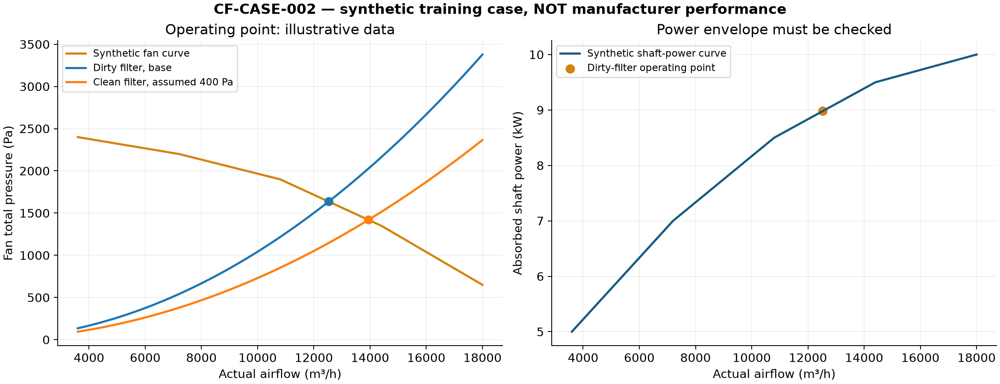
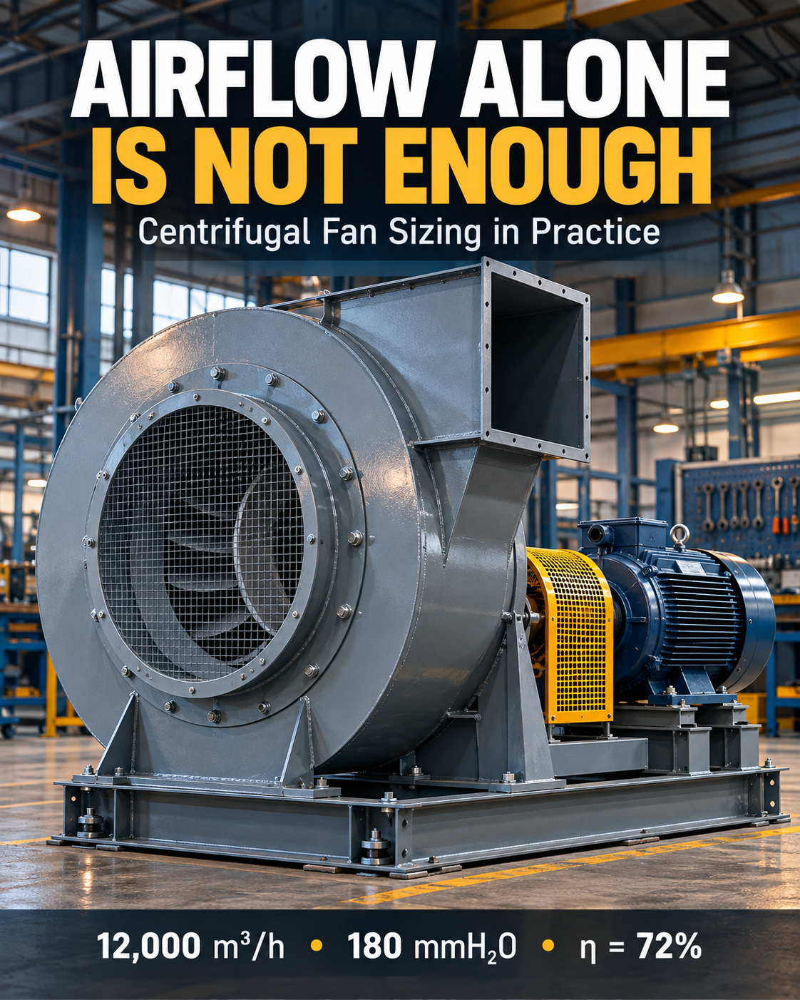
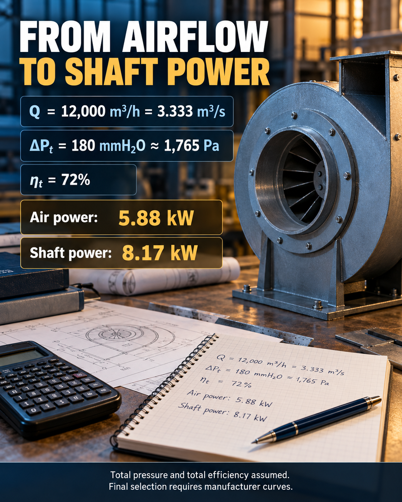
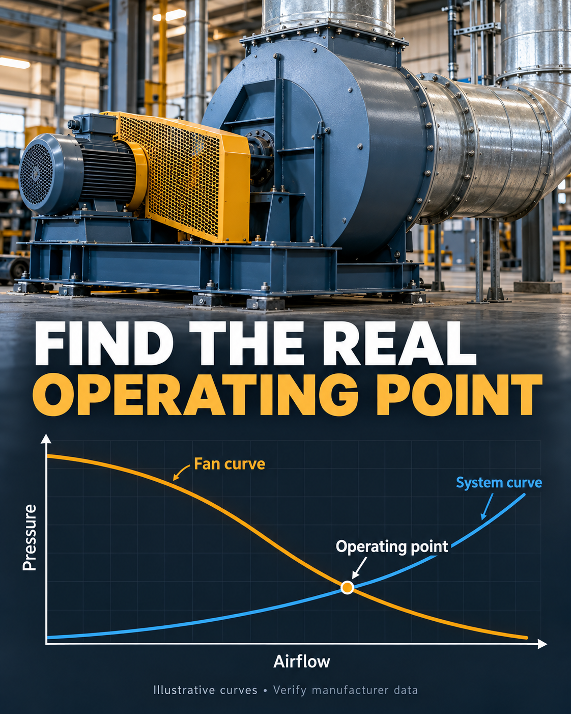

# Centrifugal Exhaust Fan Sizing Skill

**Revision 2.0 — professional engineering workflow · English / Português / Español**

A traceable preliminary engineering toolkit with detailed physics, standards applicability, procurement and commissioning controls. International technical basis with dedicated European Union and Brazil annexes. Numerical verification is provided; product certification, licensed clause compliance and project approval are not claimed.

## Technical documentation

| Document | English | Português | Español |
| --- | --- | --- | --- |
| Skill instructions | [EN](SKILL.md) | [PT](translations/pt/SKILL.md) | [ES](translations/es/SKILL.md) |
| Engineering manual | [EN](references/engineering-manual.md) | [PT](translations/pt/engineering-manual.md) | [ES](translations/es/engineering-manual.md) |
| Standards register | [EN](references/standards-register.md) | [PT](translations/pt/standards-register.md) | [ES](translations/es/standards-register.md) |
| EU / Brazil applicability | [EN](references/jurisdiction-annex.md) | [PT](translations/pt/jurisdiction-annex.md) | [ES](translations/es/jurisdiction-annex.md) |
| Procurement / FAT / SAT dossier | [EN](templates/project-dossier.md) | [PT](translations/pt/project-dossier.md) | [ES](translations/es/project-dossier.md) |
| Software and worked industrial case | [EN](references/software-and-case.md) | [PT](translations/pt/software-and-case.md) | [ES](translations/es/software-and-case.md) |

[Input contract EN/PT/ES](references/input-contract.md) · [Numerical case input](examples/industrial-case.json) · [Results](examples/industrial-case-results.json) · [Sensitivity CSV](examples/sensitivity.csv) · [Validation record](references/validation.md)

[Case review and open release items](examples/case-review.md) · [Executed local test log — 24 passed](examples/test-results.txt)

## Reproducible industrial case

The deliberately synthetic case computes segment losses with Colebrook/Darcy, a total-pressure system curve, curve intersections, shaft power and a bounded motor-envelope screen. It compares dirty/clean filters, density and speed. It is not a client delivery or a manufacturer's certified fan.



```bash
python scripts/engineering.py examples/industrial-case.json --output examples/industrial-case-results.json
python -m unittest discover -s tests -v
```

Calculation tools use the Python 3 standard library. Optional `matplotlib` reproduces the PNG/PDF plots with `python scripts/build_case.py`. The three publication illustrations below remain in English.


A practical Codex skill for preliminary centrifugal exhaust fan sizing and manufacturer-curve selection. English is the primary language, with complete Portuguese and Spanish translations.

**Languages:** [English](SKILL.md) · [Português](translations/pt/SKILL.md) · [Español](translations/es/SKILL.md)

## What it covers

- Actual versus normalized airflow and gas density.
- Duct pressure losses, system curves and operating points.
- Compatible static/total pressure and efficiency bases.
- Air power, shaft power, motor mechanical output and electrical input.
- Fan laws, operating limits and manufacturer verification.
- A reusable Python calculator with input validation.

## Installation and use

Copy this repository into your Codex skills directory as `dimensionar-exaustor-centrifugo` (for example, `~/.codex/skills/dimensionar-exaustor-centrifugo`). Invoke `$dimensionar-exaustor-centrifugo` and provide application data. Ask for English, Portuguese or Spanish output.

## Verified example

For actual inlet airflow **12,000 m³/h**, assumed **total pressure 180 mmH₂O** and **total efficiency 72%**:

| Quantity | Result |
| --- | ---: |
| Flow | 3.333333 m³/s |
| Total pressure | 1,765.197 Pa |
| Air power | 5.88399 kW |
| Shaft power | 8.172208 kW |

```bash
python scripts/calcular.py --flow-m3h 12000 --pressure 180 --unit mmca --pressure-basis total --efficiency-basis total --efficiency 0.72 --duct-velocity 10
```

Python 3 standard library only. [Calculator instructions EN/PT/ES](references/calculator.md) · [Example and technical sources](references/example-and-sources.md).

The calculator provides preliminary sizing. Final fan, impeller, speed and motor selection require manufacturer curves and the permitted operating envelope. Duct diameter is not impeller diameter.

## English publication images

AI-generated illustrative artwork; these are not photographs of a tested or selected product. The operating-point curves are illustrative. Generation prompts are included beside the images.

### 1. Airflow alone is not enough



### 2. From airflow to shaft power



### 3. Find the real operating point



## Português

Skill prática para pré-dimensionamento de exaustores centrífugos e seleção por curvas do fabricante, com cálculo rastreável. [Tradução completa](translations/pt/SKILL.md) e [exemplo técnico](translations/pt/example-and-sources.md). Copie o repositório para a pasta de skills do Codex com o nome `dimensionar-exaustor-centrifugo` e invoque `$dimensionar-exaustor-centrifugo`. Solicite resposta em português. As três imagens da publicação estão em inglês. O exemplo resulta em 8,172208 kW no eixo, assumindo pressão e eficiência totais; seleção final exige curvas e envelope operacional.

## Español

Skill práctica para predimensionamiento de extractores centrífugos y selección por curvas del fabricante, con cálculo trazable. [Traducción completa](translations/es/SKILL.md) y [ejemplo técnico](translations/es/example-and-sources.md). Copie el repositorio a la carpeta de skills de Codex con el nombre `dimensionar-exaustor-centrifugo` e invoque `$dimensionar-exaustor-centrifugo`. Solicite respuesta en español. Las tres imágenes de publicación están en inglés. El ejemplo da 8,172208 kW al eje, suponiendo presión y rendimiento totales; la selección final exige curvas y rango operativo.
